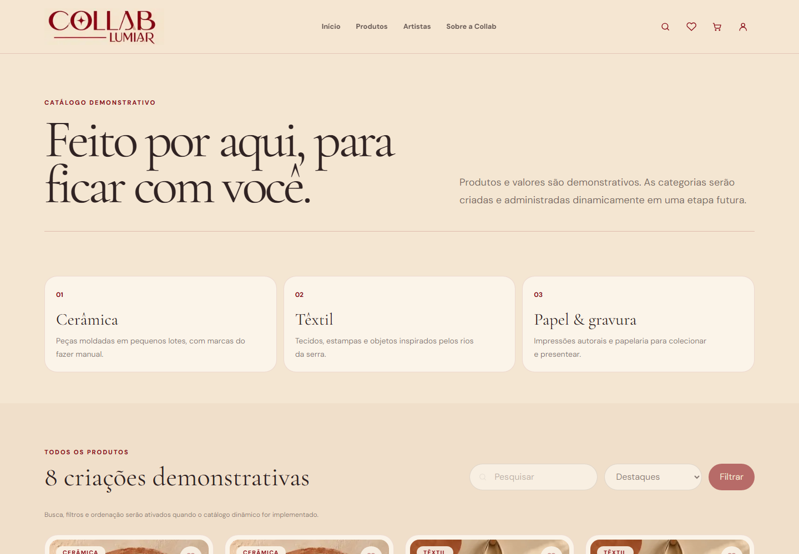
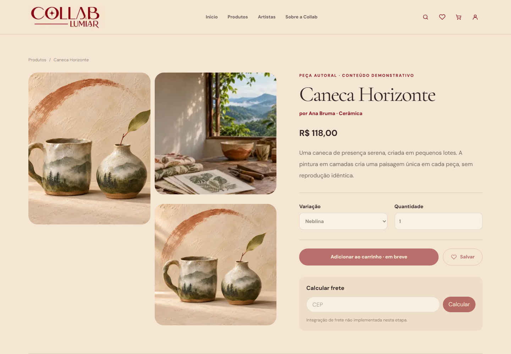
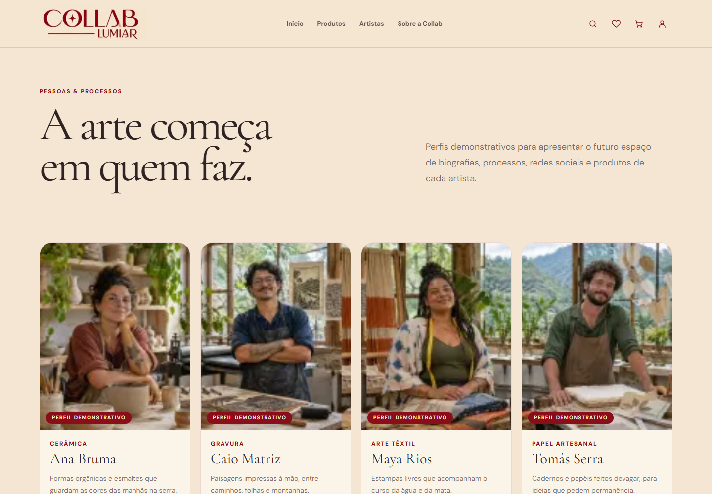
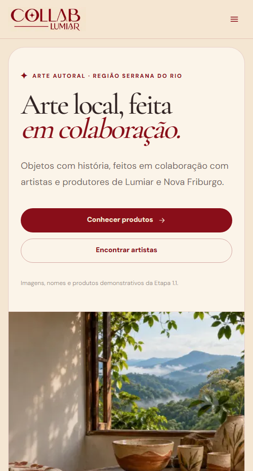
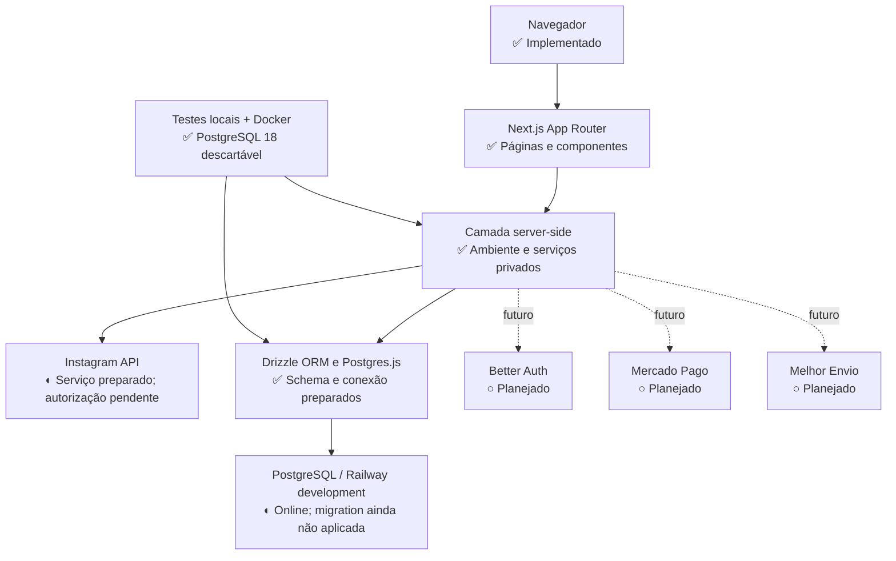

<p align="center">
  
</p>

# COLLAB LUMIAR

E-commerce colaborativo para valorizar artistas e produtores da região de
Lumiar, Nova Friburgo (RJ), desenvolvido com Next.js, TypeScript e PostgreSQL.

> **Status:** projeto real em desenvolvimento e ainda não publicado. O catálogo
> exibido atualmente é demonstrativo; autenticação, pedidos, pagamentos, frete
> e administração permanecem em desenvolvimento.

## Navegação

- [Visão geral](#visão-geral)
- [Estado do produto](#estado-do-produto)
- [Screenshots reais](#screenshots-reais)
- [Tecnologias](#tecnologias)
- [Arquitetura](#arquitetura)
- [Banco de dados](#banco-de-dados)
- [Qualidade e segurança](#qualidade-e-segurança)
- [Execução local](#execução-local)
- [Roadmap](#roadmap)
- [Direitos de uso](#direitos-de-uso)

## Visão geral

A COLLAB LUMIAR nasce para reunir, apresentar e futuramente comercializar
produtos físicos criados por artistas e produtores regionais. O projeto combina
uma experiência editorial cuidadosa com uma base técnica preparada para catálogo,
estoque, logística e evolução segura do e-commerce.

### Problema de negócio

Artistas locais frequentemente divulgam seus trabalhos em canais fragmentados,
sem uma vitrine digital compartilhada, estrutura consistente de catálogo ou um
fluxo centralizado para descoberta e compra.

### Objetivos da solução

- oferecer uma vitrine digital coerente com a identidade da marca;
- destacar artistas, histórias, técnicas e materiais dos produtos;
- preparar catálogo e estoque com regras de integridade no banco de dados;
- evoluir pagamentos, frete e autenticação sem expor credenciais;
- manter uma base testável, documentada e apropriada para operação comercial.

## Estado do produto

### Implementado

- estrutura Next.js com App Router e TypeScript estrito;
- identidade visual oficial responsiva e acessível em pt-BR;
- homepage, catálogo, detalhes de produto, artistas e páginas institucionais;
- conteúdo e imagens demonstrativos claramente identificados;
- componentes reutilizáveis de layout, produto, artista e estados vazios;
- preparação server-only da integração oficial do Instagram;
- schema Drizzle para catálogo, categorias, estoque, imagens, logística e
  endereços;
- migration SQL versionada, manifesto SHA-256, runner transacional e ledger;
- 27 testes locais e 11 cenários de integração em PostgreSQL 18 descartável;
- GitHub Actions, Gitleaks, Dependabot e política de segurança.

### Em desenvolvimento

- persistência real do catálogo e painel administrativo;
- autenticação de clientes com Better Auth;
- carrinho e favoritos persistentes;
- pedidos, avaliações e histórico de compra;
- integração de pagamentos com Mercado Pago;
- cálculo e contratação de frete com Melhor Envio;
- autorização oficial da conta Instagram;
- deploy público e operação em produção.

## Screenshots reais

As imagens abaixo são capturas da aplicação executada localmente. Elas não
representam funcionalidades ainda não implementadas.

| Página inicial                                                                  | Catálogo                                                                                    |
| ------------------------------------------------------------------------------- | ------------------------------------------------------------------------------------------- |
|  |  |

| Produto                                                                              | Artistas                                                               | Interface mobile                                                                 |
| ------------------------------------------------------------------------------------ | ---------------------------------------------------------------------- | -------------------------------------------------------------------------------- |
|  |  |  |

## Tecnologias

| Área           | Tecnologias                                                       |
| -------------- | ----------------------------------------------------------------- |
| Frontend       | Next.js 16, React 19, TypeScript, Tailwind CSS 4                  |
| Servidor       | Server Components e módulos server-only do Next.js                |
| Dados          | PostgreSQL 18, Drizzle ORM, Postgres.js                           |
| Testes         | Node.js Test Runner, TSX, PostgreSQL descartável em Docker        |
| Infraestrutura | Docker Desktop, Docker Compose e Railway                          |
| Qualidade      | Biome, TypeScript estrito, GitHub Actions e npm audit             |
| Segurança      | Gitleaks, pre-commit, variáveis privadas e controle de migrations |

## Arquitetura



Legenda: ✅ implementado · ◐ preparado/parcial · ○ planejado.

O navegador recebe apenas informações públicas. Credenciais e integrações
privadas ficam em módulos server-only. A Railway possui ambientes separados de
`development` e `production`; nenhuma migration foi aplicada remotamente nesta
fase.

## Banco de dados

O modelo foi desenhado para PostgreSQL com valores monetários em centavos,
estoque não negativo, unidades físicas padronizadas e auditoria temporal.

| Tabela               | Responsabilidade                               |
| -------------------- | ---------------------------------------------- |
| `artists`            | Perfil e estado dos artistas                   |
| `categories`         | Taxonomia hierárquica do catálogo              |
| `products`           | Conteúdo, preço e publicação dos produtos      |
| `product_categories` | Associação N:N entre produtos e categorias     |
| `product_variations` | SKU, atributos, preço opcional e estoque       |
| `product_images`     | Imagens, texto alternativo e ordenação         |
| `shipping_profiles`  | Peso e dimensões de item e embalagem           |
| `customer_addresses` | Contrato futuro de endereços para autenticação |

A migration inicial inclui PKs, FKs, checks, índices, funções e triggers para
hierarquia de categorias, publicação consistente, estoque, imagens e logística.
Ela foi validada em PostgreSQL 18 descartável, mas ainda não foi aplicada na
Railway. Veja [a documentação de migrations](docs/database-migrations.md).

## Integrações

- **Instagram:** tipos, componente e serviço oficial server-only preparados;
  depende da autorização da organizadora da conta.
- **Better Auth:** estratégia UUID planejada; tabelas oficiais ainda não foram
  geradas.
- **Mercado Pago:** planejado; nenhum pagamento é processado atualmente.
- **Melhor Envio:** planejado; o banco já contém os campos físicos necessários,
  mas não há cotação ou contratação ativa.

## Organização principal

```text
src/
├── app/                    # rotas públicas do App Router
├── components/             # componentes de marca, layout, produto e artista
├── data/                   # catálogo demonstrativo
├── db/
│   ├── schema/             # schema Drizzle por domínio
│   └── validation/         # regras de domínio testáveis
├── lib/server/             # banco, ambiente e Instagram server-only
└── types/                  # contratos TypeScript
drizzle/                    # SQL versionado e manifesto SHA-256
scripts/                    # checks, planos e runners de migration
tests/                      # testes locais e integração PostgreSQL
docs/
├── database-migrations.md  # estratégia segura de migrations
└── portfolio/              # materiais de GitHub e LinkedIn
```

## Qualidade e segurança

- TypeScript estrito e lint/format com Biome;
- testes locais de domínio, schema, manifesto e proteções de ambiente;
- suíte real em PostgreSQL 18 descartável, com rollback e concorrência;
- migration transacional com advisory lock, checksum e proteção contra
  reaplicação;
- `.env.local`, chaves, dumps, evidências e relatórios sensíveis ignorados;
- Gitleaks no hook pre-commit e em GitHub Actions com histórico completo;
- dependências auditadas com `npm audit`;
- nenhum workflow executa deploy ou altera infraestrutura.

Consulte [SECURITY.md](SECURITY.md) para reporte responsável e resposta a
possíveis vazamentos.

## Execução local

### Requisitos

- Node.js 20.9 ou superior;
- npm;
- Docker Desktop apenas para a suíte PostgreSQL de integração.

```bash
npm install
cp .env.example .env.local
npm run dev
```

No PowerShell:

```powershell
Copy-Item .env.example .env.local
npm run dev
```

A aplicação fica disponível em `http://localhost:3000`.

### Variáveis de ambiente

`.env.example` contém somente o contrato vazio. Valores reais devem permanecer
em `.env.local` durante o desenvolvimento ou no gerenciador seguro da plataforma
de hospedagem.

Somente `NEXT_PUBLIC_SUPABASE_URL` e
`NEXT_PUBLIC_SUPABASE_PUBLISHABLE_KEY` são classificadas como públicas. Banco,
Supabase Secret Key, Mercado Pago, Melhor Envio e Instagram são exclusivamente
server-side.

### Scripts

| Comando                       | Finalidade                                        |
| ----------------------------- | ------------------------------------------------- |
| `npm run dev`                 | inicia o ambiente local                           |
| `npm run lint`                | valida estilo e problemas estáticos               |
| `npm run typecheck`           | verifica os tipos TypeScript                      |
| `npm test`                    | executa os testes locais                          |
| `npm run build`               | produz o build otimizado                          |
| `npm run test:integration:db` | cria PostgreSQL 18 descartável e testa migrations |
| `npm run db:check`            | executa somente `SELECT 1` pelo túnel development |
| `npm run db:migrations:check` | confere manifesto e checksums sem conectar        |
| `npm run db:migrations:plan`  | simula offline o plano da migration               |

Os comandos de aplicação de migration possuem proteções adicionais e não fazem
parte da rotina normal de desenvolvimento.

## Roadmap

- [x] Identidade visual e páginas públicas responsivas
- [x] Catálogo e artistas demonstrativos
- [x] Schema PostgreSQL, migration versionada e testes Docker
- [x] Preparação segura da API oficial do Instagram
- [ ] Persistência e gestão real do catálogo
- [ ] Autenticação de clientes com Better Auth
- [ ] Carrinho, favoritos, pedidos e avaliações
- [ ] Mercado Pago e webhooks autenticados
- [ ] Melhor Envio e fluxo logístico
- [ ] Autorização do Instagram e deploy público

## Créditos e processo de desenvolvimento

O trabalho inclui levantamento técnico, arquitetura, implementação frontend e
backend, modelagem PostgreSQL, segurança, automação de testes, documentação e
preparação de infraestrutura. Codex e outras ferramentas de IA são utilizadas
como apoio à implementação, revisão e validação; as decisões de produto,
arquitetura e aceite permanecem sob responsabilidade humana.

Materiais adicionais para apresentação estão em
[docs/portfolio](docs/portfolio/README.md).

## Direitos de uso

Este repositório não possui licença open source permissiva. A disponibilização
do código para fins de portfólio não concede autorização para reutilizar a marca
**COLLAB LUMIAR**, o logotipo, a identidade visual, fotografias, textos de
artistas ou demais ativos comerciais.

Antes da publicação pública, os direitos do logotipo, das imagens e do conteúdo
institucional devem ser confirmados com a proprietária da marca e demais
responsáveis. Imagens demonstrativas produzidas especificamente para o protótipo
também devem ser revisadas antes do uso comercial.
