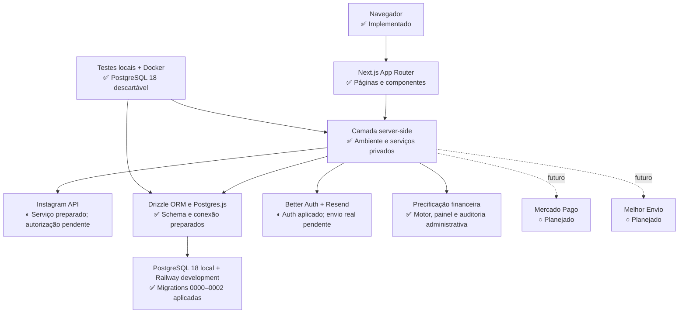

<p align="center">
  
</p>

# COLLAB LUMIAR

E-commerce colaborativo para valorizar artistas e produtores da região de
Lumiar, Nova Friburgo (RJ), desenvolvido com Next.js, TypeScript e PostgreSQL.

> **Status:** código publicado como portfólio; aplicação comercial ainda não
> implantada. A vitrine usa fixtures identificadas no modo `demo` e o catálogo
> persistido apenas no ambiente local isolado. O painel possui autenticação real,
> mas não está disponível em produção. Não há catálogo definitivo, pedidos,
> pagamentos ou contratação de frete.

## Navegação

- [Visão geral](#visão-geral)
- [Estado do produto](#estado-do-produto)
- [Capturas demonstrativas](#capturas-demonstrativas)
- [Tecnologias](#tecnologias)
- [Arquitetura](#arquitetura)
- [Banco de dados](#banco-de-dados)
- [Qualidade e segurança](#qualidade-e-segurança)
- [Execução local](#execução-local)
- [Roadmap](#roadmap)
- [Direitos de uso](#direitos-de-uso)

## Visão geral

A COLLAB LUMIAR nasce para reunir, apresentar e futuramente comercializar
produtos físicos criados por artistas e produtores regionais. O projeto combina
uma experiência editorial cuidadosa com uma base técnica preparada para catálogo,
estoque, logística e evolução segura do e-commerce.

### Problema de negócio

Artistas locais frequentemente divulgam seus trabalhos em canais fragmentados,
sem uma vitrine digital compartilhada, estrutura consistente de catálogo ou um
fluxo centralizado para descoberta e compra.

### Objetivos da solução

- oferecer uma vitrine digital coerente com a identidade da marca;
- destacar artistas, histórias, técnicas e materiais dos produtos;
- preparar catálogo e estoque com regras de integridade no banco de dados;
- evoluir pagamentos, frete e e-mail transacional sem expor credenciais;
- manter uma base testável, documentada e apropriada para operação comercial.

## Estado do produto

### Implementado

- estrutura Next.js com App Router e TypeScript estrito;
- identidade visual oficial responsiva e acessível em pt-BR;
- homepage, catálogo, detalhes de produto, artistas e páginas institucionais;
- conteúdo e imagens demonstrativos claramente identificados;
- componentes reutilizáveis de layout, produto, artista e estados vazios;
- preparação server-only da integração oficial do Instagram;
- schema Drizzle para catálogo, categorias, estoque, imagens, logística e
  endereços;
- migration SQL versionada, manifesto SHA-256, runner transacional e ledger;
- migration inicial aplicada no Railway development com backup e preflight;
- fundação Better Auth para cadastro, sessão, verificação e recuperação;
- adaptador Resend server-only e templates transacionais em HTML e texto;
- painel administrativo protegido para artistas, categorias, produtos,
  variações, estoque, metadados de imagens e logística;
- módulo financeiro administrativo com custo do artista, adicional fixo de 40%,
  divisão igualitária, regras versionadas de encargos e validação explícita,
  revisado contra um clone descartável de backup antes da migration remota;
- ambiente persistente de pré-visualização administrativa, isolado em
  PostgreSQL 18 local e com provisionamento seguro do primeiro `ADMIN`;
- vitrine integrada ao catálogo local persistido, com produtos publicados,
  artistas ativos, categorias hierárquicas, busca, filtros e paginação;
- prévia privada de rascunhos, preço público validado e revalidação após edições;
- reconciliação concluída do PostgreSQL local em volume novo, com backup
  restaurável, ledger canônico e volume original preservado para rollback;
- testes locais e integração real em PostgreSQL 18 descartável;
- GitHub Actions, Gitleaks, Dependabot e política de segurança.

### Preparado, mas sem serviço real conectado

- integração server-only do Instagram, aguardando autorização oficial da conta;
- Better Auth e templates Resend, com envio real e cadastro público desabilitados;
- campos logísticos para futura integração oficial com Melhor Envio;
- variáveis e limites de segurança para futura integração com Mercado Pago;
- contrato de armazenamento de imagens, deliberadamente sem adaptador ativo.

### Pendente

- armazenamento privado e upload real das imagens do catálogo;
- primeiro administrador em ambiente remoto autorizado;
- domínio remetente, SPF/DKIM e envio transacional real;
- inventário autorizado de artistas, produtos e fotografias;
- carrinho, favoritos, pedidos, avaliações e histórico de compra;
- pagamentos, webhooks, validação profissional de taxas e tributos;
- cotação e contratação real de frete;
- deploy público e operação em produção.

## Capturas demonstrativas

As imagens abaixo são capturas reais da interface pública em modo demonstrativo,
produzidas antes da integração do catálogo persistido. Elas preservam a
identidade visual atual, mas não representam dados reais, operação comercial ou
as telas administrativas mais recentes. Novas capturas do dashboard e do
financeiro dependem de revisão da proprietária antes de serem versionadas.

| Página inicial                                                                  | Catálogo                                                                                    |
| ------------------------------------------------------------------------------- | ------------------------------------------------------------------------------------------- |
|  |  |

| Produto                                                                              | Artistas                                                               | Interface mobile                                                                 |
| ------------------------------------------------------------------------------------ | ---------------------------------------------------------------------- | -------------------------------------------------------------------------------- |
|  |  |  |

## Tecnologias

| Área           | Tecnologias                                                       |
| -------------- | ----------------------------------------------------------------- |
| Frontend       | Next.js 16, React 19, TypeScript, Tailwind CSS 4                  |
| Servidor       | Server Components e módulos server-only do Next.js                |
| Dados          | PostgreSQL 18, Drizzle ORM, Postgres.js                           |
| Autenticação   | Better Auth 1.7, Resend, sessões e papéis CUSTOMER/ADMIN          |
| Testes         | Node.js Test Runner, TSX, PostgreSQL descartável em Docker        |
| Infraestrutura | Docker Desktop, Docker Compose e Railway                          |
| Qualidade      | Biome, TypeScript estrito, GitHub Actions e npm audit             |
| Segurança      | Gitleaks, pre-commit, variáveis privadas e controle de migrations |

## Arquitetura



Legenda: ✅ implementado · ◐ preparado/parcial · ○ planejado.

O navegador recebe apenas informações públicas. Credenciais e integrações
privadas ficam em módulos server-only. A Railway possui ambientes separados de
`development` e `production`; as migrations de catálogo, autenticação e
precificação financeira foram aplicadas em development, cada uma com backup,
preflight e autorização explícita.

## Banco de dados

O modelo foi desenhado para PostgreSQL com valores monetários em centavos,
estoque não negativo, unidades físicas padronizadas e auditoria temporal.

| Tabela               | Responsabilidade                                  |
| -------------------- | ------------------------------------------------- |
| `artists`            | Perfil e estado dos artistas                      |
| `categories`         | Taxonomia hierárquica do catálogo                 |
| `products`           | Conteúdo, preço e publicação dos produtos         |
| `product_categories` | Associação N:N entre produtos e categorias        |
| `product_variations` | SKU, atributos, preço opcional e estoque          |
| `product_images`     | Imagens, texto alternativo e ordenação            |
| `shipping_profiles`  | Peso e dimensões de item e embalagem              |
| `customer_addresses` | Contrato futuro de endereços para autenticação    |
| `financial_*`        | Políticas, encargos, custos, cenários e auditoria |

A migration inicial inclui PKs, FKs, checks, índices, funções e triggers para
hierarquia de categorias, publicação consistente, estoque, imagens e logística.
Ela foi validada em PostgreSQL 18 descartável e aplicada exclusivamente na
Railway development. As migrations `0001_collab_auth` e
`0002_collab_financial_pricing` também foram aplicadas pelo runner controlado.
A `0002` passou antes por rotação preventiva da credencial, novo backup custom,
restauração comparada e ensaio em clone PostgreSQL 18 descartável. Veja
[a documentação de migrations](docs/database-migrations.md) e o [modelo
financeiro](docs/financial-model.md).

## Integrações

- **Instagram:** tipos, componente e serviço oficial server-only preparados;
  depende da autorização da organizadora da conta.
- **Better Auth + Resend:** servidor, cliente, rota, sessões, páginas, schema
  UUID, adaptador e templates preparados; cadastro público e envio real seguem
  desabilitados até domínio, credenciais e segurança serem validados.
- **Mercado Pago:** planejado; nenhum pagamento é processado atualmente.
- **Melhor Envio:** planejado; o banco já contém os campos físicos necessários,
  mas não há cotação ou contratação ativa.

## Organização principal

```text
src/
├── app/                    # rotas públicas do App Router
├── components/             # componentes públicos e administrativos
├── data/                   # catálogo demonstrativo
├── db/
│   ├── schema/             # schema Drizzle por domínio
│   └── validation/         # regras de domínio testáveis
├── lib/server/             # banco, autenticação, catálogo e integrações privadas
└── types/                  # contratos TypeScript
drizzle/                    # SQL versionado e manifesto SHA-256
scripts/                    # checks, planos e runners de migration
tests/                      # testes locais e integração PostgreSQL
docs/
├── database-migrations.md  # estratégia segura de migrations
├── authentication.md       # Better Auth e e-mail transacional
├── admin-dashboard.md      # rotas, segurança e limites do painel
├── financial-model.md      # regras, arredondamentos e limites financeiros
├── local-admin-preview.md  # guia iniciante do painel administrativo local
├── public-catalog-integration.md # contratos públicos do catálogo
├── performance-audit.md    # medições e limites da auditoria local
├── local-database-reconciliation.md # recuperação segura local
└── portfolio/              # materiais de GitHub e LinkedIn
```

## Qualidade e segurança

- TypeScript estrito e lint/format com Biome;
- testes locais de domínio, schema, manifesto e proteções de ambiente;
- suíte real em PostgreSQL 18 descartável, com rollback e concorrência;
- migration transacional com advisory lock, checksum e proteção contra
  reaplicação;
- `.env.local`, chaves, dumps, evidências e relatórios sensíveis ignorados;
- Gitleaks no hook pre-commit e em GitHub Actions com histórico completo;
- dependências auditadas com `npm audit`;
- nenhum workflow executa deploy ou altera infraestrutura.

Consulte [SECURITY.md](SECURITY.md) para reporte responsável e resposta a
possíveis vazamentos.

## Execução local

### Requisitos

- Node.js 20.19 ou superior;
- npm;
- Docker Desktop para o PostgreSQL local e para a suíte descartável de integração.

```powershell
npm ci
npm run local:setup
npm run local:start
```

O fluxo cria a configuração privada fora do Git, inicia somente o PostgreSQL
local identificado e abre o Next.js em `127.0.0.1`. A aplicação deve ser
acessada exatamente em `http://localhost:3000`. O primeiro `ADMIN` local é
provisionado separadamente e apenas uma vez; consulte o guia antes de executar
qualquer comando administrativo.

### Variáveis de ambiente

`.env.example` contém somente o contrato vazio. Valores reais devem permanecer
em `.env.local` durante o desenvolvimento ou no gerenciador seguro da plataforma
de hospedagem.

Banco, Better Auth, e-mail, Mercado Pago, Melhor Envio e Instagram são
exclusivamente server-side. Nenhuma credencial de autenticação utiliza o prefixo
`NEXT_PUBLIC_`.

`CATALOG_DATA_SOURCE` aceita somente `demo` ou `persisted-local`. O comando
`local:start` seleciona o segundo modo e valida obrigatoriamente o banco local em
`127.0.0.1:55432`; ele não aceita uma conexão Railway. Consulte
[Integração do catálogo público](docs/public-catalog-integration.md).

### Scripts

| Comando                       | Finalidade                                        |
| ----------------------------- | ------------------------------------------------- |
| `npm run dev`                 | inicia só o Next.js; exige ambiente configurado   |
| `npm run lint`                | valida estilo e problemas estáticos               |
| `npm run typecheck`           | verifica os tipos TypeScript                      |
| `npm test`                    | executa os testes locais                          |
| `npm run build`               | produz o build otimizado                          |
| `npm run test:integration:db` | cria PostgreSQL 18 descartável e testa migrations |
| `npm run db:check`            | executa somente `SELECT 1` pelo túnel development |
| `npm run db:migrations:check` | confere manifesto e checksums sem conectar        |
| `npm run db:migrations:plan`  | simula offline o plano da migration               |
| `npm run local:setup`         | prepara PostgreSQL 18 persistente e migrations    |
| `npm run local:admin:create`  | provisiona uma única conta ADMIN local            |
| `npm run local:start`         | inicia banco local e Next.js em `127.0.0.1`       |
| `npm run local:stop`          | encerra somente o banco local e preserva os dados |

Os comandos de aplicação de migration possuem proteções adicionais e não fazem
parte da rotina normal de desenvolvimento.

> A divergência local da `0002` foi recuperada em um volume novo. O volume
> original permanece preservado e não deve receber edição de ledger. Consulte o
> [registro da reconciliação local](docs/local-database-reconciliation.md).

## Roadmap

- [x] Identidade visual e páginas públicas responsivas
- [x] Catálogo e artistas demonstrativos
- [x] Schema PostgreSQL, migration versionada e testes Docker
- [x] Preparação segura da API oficial do Instagram
- [x] Persistência, gestão local e integração segura do catálogo à vitrine
- [x] Painel administrativo local protegido e CRUD do catálogo
- [x] Motor e painel local de precificação com auditoria financeira
- [x] Pré-visualização administrativa persistente e isolada da Railway
- [x] Aplicar a migration financeira controlada em development
- [ ] Validar profissionalmente taxas e tributos antes da operação comercial
- [ ] Armazenamento privado e primeiro ADMIN remoto autorizado
- [x] Fundação local da autenticação de clientes com Better Auth
- [x] Migration de autenticação aplicada no development
- [ ] Domínio Resend validado e e-mail testado no development
- [ ] Carrinho, favoritos, pedidos e avaliações
- [ ] Mercado Pago e webhooks autenticados
- [ ] Melhor Envio e fluxo logístico
- [ ] Autorização do Instagram e deploy público

## Créditos e processo de desenvolvimento

O trabalho inclui levantamento técnico, arquitetura, implementação frontend e
backend, modelagem PostgreSQL, segurança, automação de testes, documentação e
preparação de infraestrutura. Codex e outras ferramentas de IA são utilizadas
como apoio à implementação, revisão e validação; as decisões de produto,
arquitetura e aceite permanecem sob responsabilidade humana.

Materiais adicionais para apresentação estão em
[docs/portfolio](docs/portfolio/README.md).

## Direitos de uso

Este repositório não possui licença open source permissiva. A disponibilização
do código para fins de portfólio não concede autorização para reutilizar a marca
**COLLAB LUMIAR**, o logotipo, a identidade visual, fotografias, textos de
artistas ou demais ativos comerciais.

O uso público atual foi autorizado para fins de portfólio. Novas fotografias,
textos de artistas e itens do inventário deverão passar por uma nova revisão de
direitos antes de serem incluídos ou usados comercialmente.
